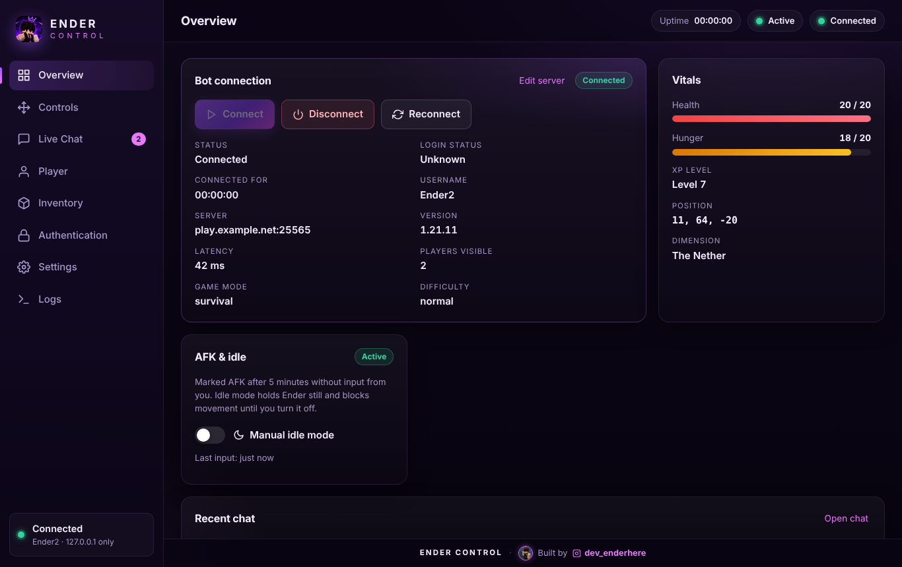
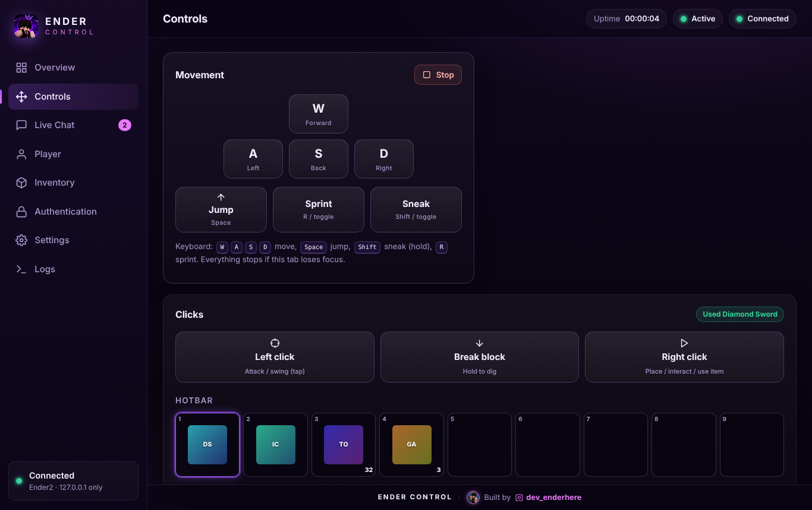
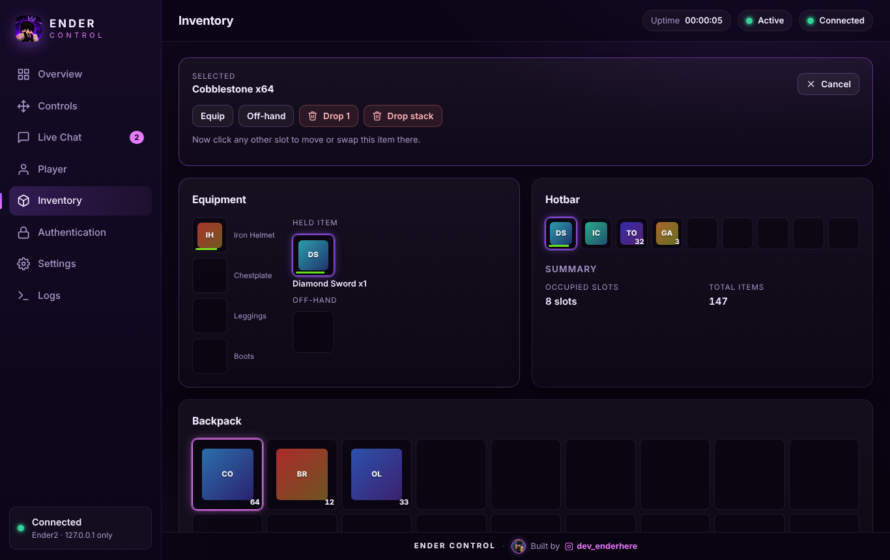
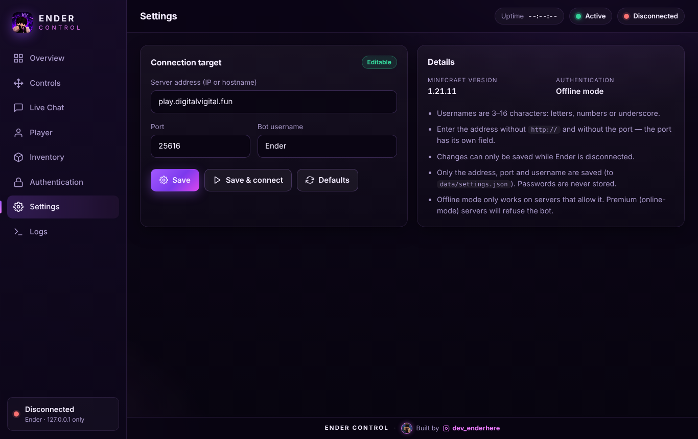
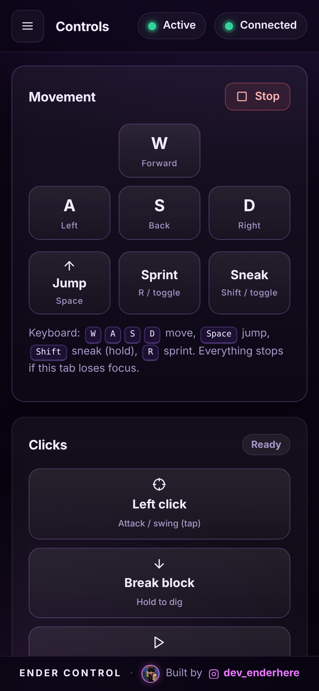

<p align="center">
  
</p>

A polished, local web dashboard for managing a **Minecraft Java Edition bot**. Connect, walk, look around,
click, chat, manage the inventory and watch live logs from a dark gaming UI that works on desktop and mobile.

Built with Node.js, [Mineflayer](https://github.com/PrismarineJS/mineflayer), Express and Socket.IO.
The dashboard only ever listens on `127.0.0.1`.



<p>
  
  
</p>
<p>
  
  
</p>

## Quick start

Requires Node.js 18 or newer.

```bash
git clone <your-repo-url> ender-control
cd ender-control
npm install
npm start
```

Open <http://127.0.0.1:3000>, go to **Settings**, enter your server address, port and bot username,
then press **Save & connect**.

Defaults (used until you save your own settings) are in `src/config.js`:
`play.digitalvigital.fun:25616`, Minecraft `1.21.11`, username `Ender`, offline mode.

Optional environment variables: `ENDER_PORT` (dashboard port, default 3000), `ENDER_SERVER_HOST`,
`ENDER_SERVER_PORT`, `ENDER_MC_VERSION`.

```bash
ENDER_PORT=3100 npm start
```

## Features

- **Overview** - connect / disconnect / reconnect, live status, login status, connection duration,
  server info (version, latency, players, game mode), error banner, AFK indicator and manual idle mode.
- **Settings** - edit the server address (IP or hostname), port and bot username from the browser.
  Saved to `data/settings.json` (never passwords) and used from the next connect. Locked while the bot is connected.
- **Controls** - on-screen WASD, jump, sprint and sneak with keyboard and touch support, plus a Stop button.
  Camera: drag pad, hold-to-look buttons, arrow keys, yaw / pitch sliders, sensitivity, reset.
- **Clicks** - left click (attack / swing), hold-to-break block, right click (place / interact / use item).
  They act on whatever is under the bot's crosshair. A quick tap on the camera pad is a left click,
  right-clicking the pad is a right click.
- **Inventory** - backpack, hotbar, armor, off-hand and held item with counts and durability, plus full control:
  click an item to select it, then **Hold**, **Equip** (armor goes to the right slot automatically),
  **Off-hand**, **Unequip**, **Drop 1**, **Drop stack**, or click another slot to **move / swap** it.
  Only the bot's own inventory is touched (no chests or trading).
- **Live Chat** - colour-coded server messages with timestamps, filter + search, send messages and commands, clear.
- **Player** - health, hunger, XP, coordinates, dimension, facing / compass, game mode, active controls.
- **Authentication** - manual `/login` or `/register` through a password field.
- **Logs** - connection, chat and error logs with live toast notifications.

### Keyboard (Controls page)

| Key | Action |
|---|---|
| `W` `A` `S` `D` | Move (hold) |
| `Space` | Jump (hold) |
| `Shift` | Sneak (hold) |
| `R` | Toggle sprint |
| `1` - `9` | Select hotbar slot |
| Arrow keys | Nudge camera |
| `Esc` | Cancel inventory selection (Inventory page) |

All movement stops automatically if the tab loses focus or you leave the Controls page.

## Security notes

- The server binds to `127.0.0.1` only. Requests whose `Host` or `Origin` is not the local dashboard are
  rejected (blocks DNS rebinding and cross-site WebSocket use).
- A strict Content-Security-Policy is sent; the frontend never uses `innerHTML` for server data.
- Every Socket.IO event is rate limited, validated and acknowledged with `{ ok, error }`. Connection settings are
  validated (hostname / IPv4, port 1-65535, 3-16 character username) and can only change while disconnected.
  Inventory and click actions are blocked while idle mode is on.
- Passwords are passed straight to the server as `/login` / `/register`. They are never stored, logged,
  echoed to chat or written to disk, and the input is cleared the moment you submit.
  `/login`, `/register` and similar commands are blocked in the chat box so a password cannot end up in chat history.
- Only one bot connection can exist at a time; connection attempts are spaced out (5 s) to respect server throttling.
- Logs live in memory only.
- **AFK**: the indicator is passive. It never sends movement, jumps or chat to avoid AFK detection.
  *Idle mode* simply holds the bot still and blocks input.

Only connect the bot to servers you own or have permission to use bots on, and follow their rules.

## Project structure

```
ender-control/
  package.json  LICENSE  README.md
  src/
    index.js              entry point (startup, shutdown, global error guards)
    config.js             default target + limits
    bot/
      BotManager.js       lifecycle state machine, editable target, events, duplicate prevention
      movement.js         WASD / jump / sprint / sneak
      camera.js           yaw / pitch control
      actions.js          left / right click, hold-to-break
      inventory.js        inventory snapshot
      inventoryControl.js select / equip / drop / move
      chat.js             incoming chat + validated sending
      player.js           player + server snapshots
      afk.js              AFK indicator + manual idle mode
    server/
      app.js              Express + Socket.IO setup, host / origin / CSP protection
      socket.js           event handlers (validation + rate limits)
    utils/
      logger.js           in-memory ring-buffer logger
      settings.js         saves / loads the connection target (data/settings.json)
      validate.js         input validation and sanitising
  public/
    index.html  favicon.ico, apple-touch-icon.png
    img/                  logo, sidebar mark, developer avatar
    css/                  theme.css, layout.css, components.css
    js/
      main.js, socket.js, store.js, util.js
      modules/            nav, connection, settings, controls, camera, clicks, hotbar,
                          chat, player, inventory, auth, logs
  scripts/
    check.js              syntax + element-id + CSP checks             (npm run check)
    smoke-test.js         end-to-end test with a fake bot              (npm test)
    ui-test.js            real-browser test, refreshes screenshots     (npm run test:ui)
    fake-bot.js           fake Mineflayer bot used by the tests
  docs/                   screenshots/, social-preview.jpg (GitHub social preview, 1280x640),
                          logo-alternatives/ (earlier logo concepts)
```

## Testing

```bash
npm run check     # JavaScript syntax for every file, HTML id cross-check, CSP hygiene
npm test          # real server + Socket.IO client + fake bot (offline)
npm run test:ui   # real Chromium test of every page (optional, see below)
```

None of the tests contact a Minecraft server. The browser test needs Playwright, which is not a dependency:

```bash
npm install --no-save playwright
npx playwright install chromium
npm run test:ui
```

## Troubleshooting

| Message | Meaning |
|---|---|
| *Server address could not be resolved* | DNS lookup for the server failed - check the address and your connection. |
| *Connection refused* | The server is offline or the port is wrong. |
| *Kicked: ...* | The server removed the bot; the reason is shown on the Overview page. |
| *Please wait Ns before reconnecting* | Built-in cooldown to avoid connection throttling. |
| *Disconnect the bot before changing connection settings* | Settings are locked while connected. |
| Login status stays *Unknown* | It is detected from the server's own messages; some servers word them differently. |
| *Port 3000 is already in use* | Start with another port: `ENDER_PORT=3100 npm start`. |

If the server uses online-mode authentication (Mojang / Microsoft accounts), an offline-mode bot will be
refused. This dashboard does not work around that.

## License

[MIT](LICENSE)

---

 Built by [@dev_enderhere](https://www.instagram.com/dev_enderhere/)
